# 🏥 Hastane Randevu - Hospital Appointment System (C# & SQL Server)

🇬🇧 **English** · 🇹🇷 [Türkçe](README.tr.md)

A Windows Forms application built with .NET 10 and SQL Server in which patients book, list and cancel
appointments with doctors, and doctors see and cancel the appointments made with them. The screens and rules are
inspired by public hospital booking portals; the project is an independent educational application and is not
connected to any official system. The code is split into Domain, Business, Data and UI layers; database access
uses EF Core, and the database is created and migrated automatically on startup.

> The application's user interface is in Turkish. Screen and button names below are given with their Turkish
> labels followed by an English translation, e.g. "Randevu Al" (Book Appointment).

---

## 📦 Features

### Patient panel

- ✅ **Registration** ("Üye Ol", Register): full name, national identity number ("T.C. Kimlik No") and a
  password of 8-64 characters. The national id is checked for 11 digits and its checksum, and can be registered
  only once.
- ✅ **Sign-in** ("Giriş Yap", Sign In) with the national id and the password.
- ✅ **Booking** ("Randevu Al", Book Appointment): choose a doctor ("Doktor Seçiniz", Select Doctor) with their
  branch, a day ("Tarih Seçiniz", Select Date) and a free time ("Saat Seçiniz", Select Time).
- ✅ **Doctor search** ("Doktor Ara", Find Doctor): filter the doctors by name and branch (Turkish letters or not).
- ✅ **First free slot** ("İlk Boş Randevu", First Free Slot): the selected doctor's earliest free slot within the
  90 day window is found by the service and shown in the pickers, ready to book.
- ✅ **Calendar** ("Takvim", Calendar): the selected doctor's month or week with free (and how many), full, leave,
  off and out-of-window days; choosing a free day shows its slots.
- ✅ **My appointments** ("Aktif Randevularım", My Active Appointments): the patient's own appointments that are not cancelled,
  which can be cancelled ("Randevu İptal", Cancel Appointment) after a confirmation.
- ✅ **Rescheduling** ("Ertele", Reschedule): an own appointment is moved to a free slot of the same doctor in one
  atomic step (no cancellation and no new appointment). It must not have started and must be at least
  `Appointments:RescheduleCutoffHours` hours away (default 2); the new time follows the booking rules.
- ✅ **Reminders**: after sign-in the appointments starting within `Appointments:ReminderLeadHours` (default 24) are
  shown inside the window and, if `Appointments:ShowReminderBalloon` is on, once as a notification balloon that never
  takes the focus.
- ✅ **History export** ("Geçmişi Dışa Aktar", Export History): the patient's own appointments, cancelled ones
  included, as CSV (UTF-8 with BOM, `;` separator, formula injection neutralised, national id masked).

### Doctor panel

- ✅ **Sign-in** ("Doktor Giriş", Doctor Sign In) with the doctor's full name and password.
- ✅ **Appointments** ("Sisteme Kayıtlı Randevular", Booked Appointments): the patients and times of the
  appointments made with this doctor, which can be cancelled ("İptal Et", Cancel).
- ✅ **Working schedule** ("Çalışma Programım", My Schedule): the doctor's own working days and hours (30 minute
  steps, 00:00-24:00) and leave or holiday days. Existing appointments are never changed; those that fall on a leave
  day or outside the new hours are listed as warnings.
- ✅ **Daily agenda** ("Ajandayı Dışa Aktar", Export Agenda): the doctor's appointments of a chosen day as a
  printable HTML page (no scripts, a restrictive content security policy, every value HTML encoded, national ids
  masked).

### Appointment rules

- ✅ 30 minute slots from each doctor's working hours, without their leave days. A doctor who never saved a
  schedule works weekdays from 09:00 to 17:00 (the last slot starts at 16:30), the original rule, so existing
  databases behave as before.
- ✅ Only future slots, at most 90 calendar days ahead (day 90 included).
- ✅ One active appointment per doctor and slot; a cancelled slot becomes free again.
- ✅ Cancellation only before the appointment starts; cancelled appointments are kept as history.
- ✅ Times are local wall clock times, as stored by the original application.

### Security

- ✅ Passwords are stored as PBKDF2-HMAC-SHA256 hashes (600,000 iterations, random salt).
- ✅ 5 failed sign-ins lock the account for 15 minutes; locked accounts, unknown accounts and wrong passwords get
  the same answer.
- ✅ Every appointment call is checked against the signed-in session, so an account cannot reach other accounts'
  appointments by passing their ids.
- ✅ Central FluentValidation validators with Turkish messages; write buttons ignore repeated clicks while an
  operation is pending.
- ✅ Daily log files without personal data, with anonymous audit codes for sign-in, lockout and appointments.

---

## 🖼️ Screenshots

The images are drawn offscreen by `tools/Screenshots` with an invented hospital (made-up names, national ids that only
pass the checksum and are shown masked); no window is opened. Select an image for its 2x version. To draw them again:
`dotnet run --project tools/Screenshots -c Release -- screenshots`.

| | |
|---|---|
| [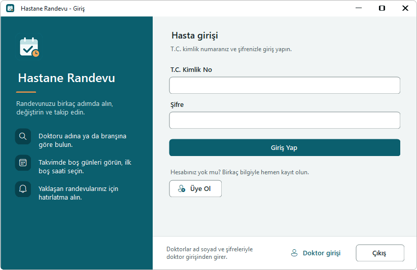](screenshots/hasta-girisi-2x.png)<br>**Patient sign-in** ("Hasta girişi") | [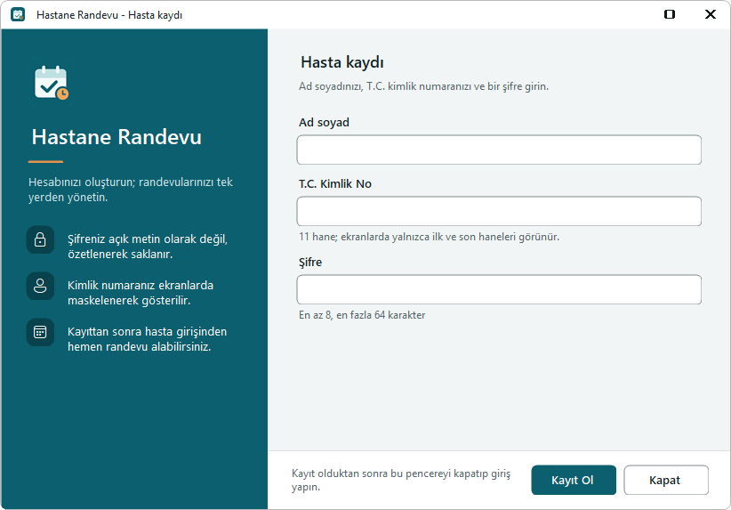](screenshots/hasta-kaydi-2x.png)<br>**Registration** ("Hasta kaydı") |
| [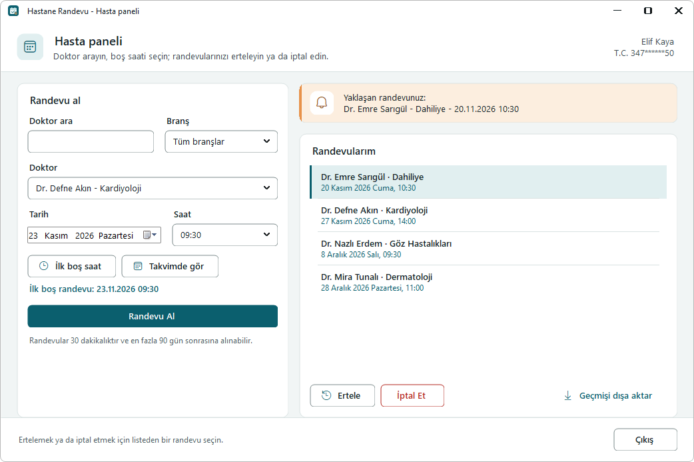](screenshots/hasta-paneli-2x.png)<br>**Patient panel** ("Hasta paneli"): booking, first free slot, reminder and appointments | [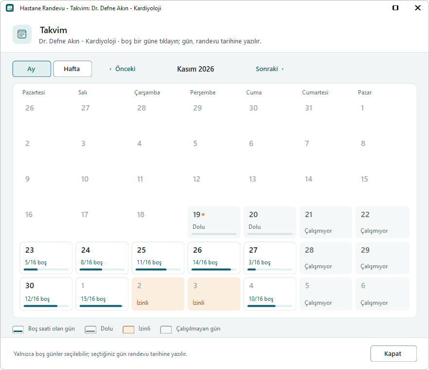](screenshots/randevu-takvimi-2x.png)<br>**Calendar** ("Takvim"), month view with free, full, leave and off days |
| [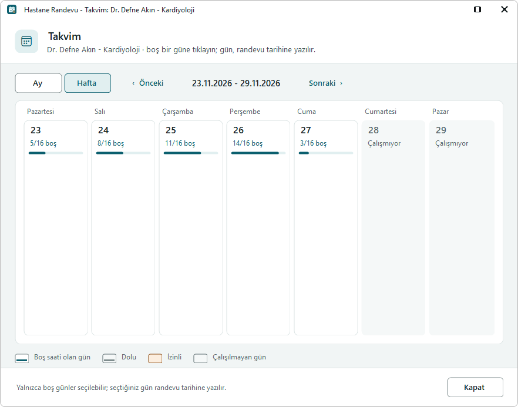](screenshots/randevu-takvimi-hafta-2x.png)<br>**Calendar**, week view | [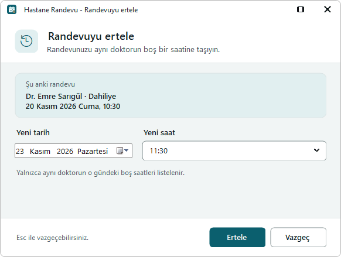](screenshots/randevu-erteleme-2x.png)<br>**Rescheduling** ("Randevuyu ertele") |
| [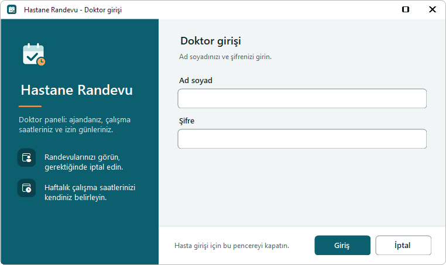](screenshots/doktor-girisi-2x.png)<br>**Doctor sign-in** ("Doktor girişi") | [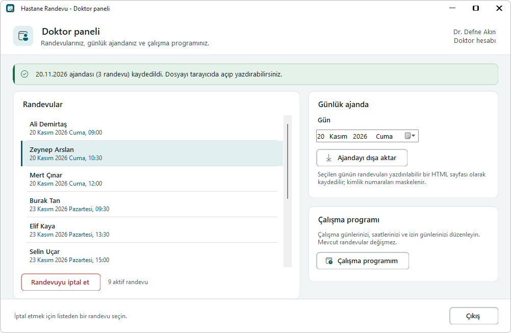](screenshots/doktor-paneli-2x.png)<br>**Doctor panel** ("Doktor paneli") after an agenda export |
| [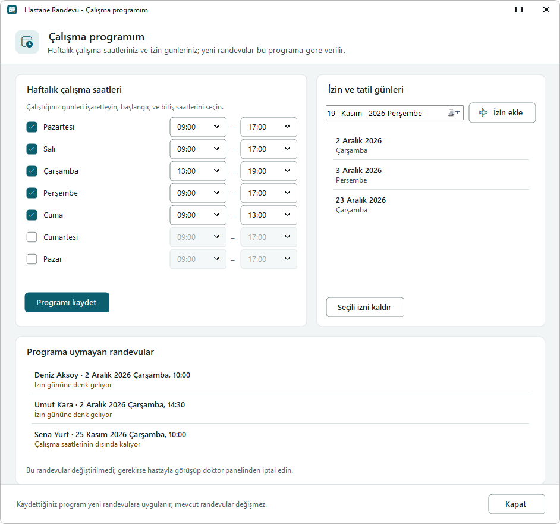](screenshots/calisma-programi-2x.png)<br>**Working schedule** ("Çalışma programım") with leave days and conflicts | [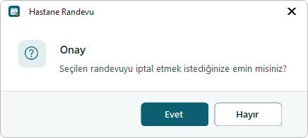](screenshots/onay-penceresi-2x.png)<br>**Confirmation** ("Onay") before a cancellation |

---
## 🔑 Permission Matrix

| Action | Patient | Doctor |
|---|---|---|
| Register a patient account | ✅ (from the sign-in screen) | ❌ |
| Sign in | ✅ national id + password | ✅ full name + password |
| List doctors and branches | ✅ | ✅ (not shown in the doctor panel) |
| See free slots of a doctor | ✅ | ❌ |
| Book an appointment | ✅ for themselves only | ❌ |
| List appointments | ✅ their own | ✅ those made with them |
| Cancel an appointment | ✅ their own, before it starts | ✅ those made with them, before they start |
| Change working hours and leave days | ❌ | ✅ their own only |
| Reschedule an appointment | ✅ their own, up to the cut-off | ❌ |
| See or change other accounts' appointments | ❌ | ❌ |

---

## 🧰 Tech Stack

| Area | Used |
|---|---|
| Platform | .NET 10 (`net10.0-windows` UI, `net10.0` libraries) |
| UI | Windows Forms |
| Data access | Entity Framework Core 10 (SQL Server provider) |
| Database | Microsoft SQL Server (Express or LocalDB is enough) |
| Password hashing | PBKDF2-HMAC-SHA256 (`Rfc2898DeriveBytes.Pbkdf2`) |
| Validation | FluentValidation |
| Configuration / DI | Microsoft.Extensions.Configuration (JSON, user secrets, environment), Microsoft.Extensions.DependencyInjection |
| Logging | Serilog (file sink, daily rolling) |
| Testing | xUnit v3, Moq, EF Core SQLite (in-memory), optional real SQL Server tests |
| CI | GitHub Actions (`.github/workflows/ci.yml`) |

---

## 🗂️ Project Structure

```text
HastaneRandevuSistemi/
├── src/
│   ├── HastaneRandevu.Domain/     # Entities (Patient, Doctor, Appointment) and repository contracts
│   ├── HastaneRandevu.Business/   # AuthService, AppointmentService, Security/ (PBKDF2, lockout), Validation/ (FluentValidation), Auditing/
│   ├── HastaneRandevu.Data/       # EF Core DbContext, configurations, Migrations/, legacy upgrade, repositories
│   └── HastaneRandevu.UI/         # WinForms screens, Infrastructure/ (errors, logging, dialogs, write guard), Program.cs (composition root)
├── tests/
│   ├── HastaneRandevu.Business.Tests/  # Validators, rules, hashing, lockout and ownership (Moq)
│   ├── HastaneRandevu.Data.Tests/      # Services and repositories on SQLite; races and legacy upgrade on SQL Server
│   └── HastaneRandevu.UI.Tests/        # Configuration, errors, logs, dialogs, focus and write guards (no windows shown)
├── assets/                        # Original logo, background and icon with their SVG sources
├── docs/THREAT_MODEL.md           # Threat model
├── .github/workflows/ci.yml       # Build, test and release workflow
├── CHANGELOG.md
└── HastaneRandevu.sln
```

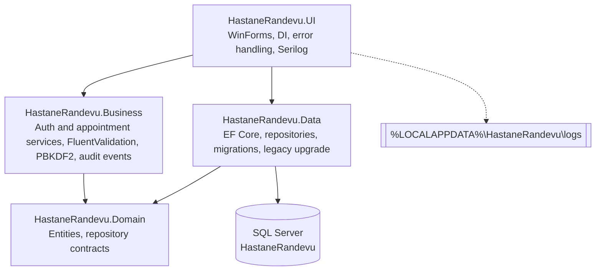

The UI references Data only to register dependencies at startup; forms work through the Business services, which
take the signed-in session on every call. All database access is asynchronous and parameterised. The provider is
configured through DI (`AddDataAccess`), so tests can use SQLite in-memory.

---

## 🛠️ Setup and Usage

### Requirements

- .NET 10 SDK (Windows)
- SQL Server (Express or LocalDB is enough)

### 1. Configuration

Provide a connection string named `HastaneRandevu`. Any of the following works (later ones override earlier ones):

1. **`appsettings.json`**: copy `src/HastaneRandevu.UI/appsettings.example.json` to `appsettings.json` in the
   same folder and edit `ConnectionStrings:HastaneRandevu`. `appsettings.json` is git-ignored.

   ```json
   {
     "ConnectionStrings": {
       "HastaneRandevu": "Server=localhost\\SQLEXPRESS;Database=HastaneRandevu;Trusted_Connection=True;TrustServerCertificate=True;"
     }
   }
   ```

2. **User secrets**:

   ```powershell
   dotnet user-secrets set "ConnectionStrings:HastaneRandevu" "<connection string>" --project src/HastaneRandevu.UI
   ```

3. **Environment variable** `ConnectionStrings__HastaneRandevu`.
4. **Environment variable** `HASTANE_CONNECTION` (highest priority).

> Inside JSON the `\` in `localhost\SQLEXPRESS` is written as `\\`. `TrustServerCertificate=True` is meant for a
> local development server only.

If no connection string is found, the application shows a Turkish message explaining these options and exits.

The `Appointments` section holds the configurable rules (defaults shown); invalid values stop the application with
a Turkish message that names the setting:

```json
"Appointments": {
  "RescheduleCutoffHours": 2,
  "ReminderLeadHours": 24,
  "ShowReminderBalloon": true
}
```

| Setting | Meaning | Allowed |
|---|---|---|
| `RescheduleCutoffHours` | An appointment can be rescheduled until this many hours before it starts | 0-168 |
| `ReminderLeadHours` | Appointments starting within this many hours are announced after sign-in | 1-168 |
| `ShowReminderBalloon` | Also show reminders as a notification balloon (never takes the focus) | `true` / `false` |

### 2. Running

```powershell
dotnet build -c Release
dotnet run --project src/HastaneRandevu.UI
```

The database is created on first start; pending migrations are applied automatically on every start, so no
manual `dotnet ef database update` and no `.bak` file are needed.

### 3. Upgrading an existing database

A database created by the original application (tables `Hastalar`, `Doktorlar` and `Randevular` without a
migrations history) is upgraded in place on first start: existing rows and identity values are kept, the missing
columns, constraints and indexes are added and the migrations are recorded as applied, so no sample data is
inserted. The plain text passwords of that version are marked as such and replaced with a hash on each account's
next successful sign-in. The upgrade runs in one transaction under an application lock (`sp_getapplock`, whose
return code is checked) and is safe to repeat. If existing rows break the new rules (for example two doctors with
the same name, or one doctor booked twice at the same time), the upgrade stops before changing anything and
reports only counts, never names or national ids.

Take a backup of the database before the first start with the new version, and keep it protected: it still
contains the plain text passwords.

### 4. Demo mode

By default the database is created empty: the migrations create no account, so no published password works.
Patients register themselves; the application has no screen for adding doctors, so doctor accounts are
inserted into `Doktorlar` by the operator (with a PBKDF2 hash, `SifreBicimi = 0`).

Demo mode is off unless it is switched on explicitly, with the environment variable `HASTANE_DEMO=1` or the
setting `"Seed": { "Demo": true }`. Only then, and only when the database has no patient, doctor or appointment
yet, are these fictional accounts added on start (synthetic national ids that only pass the checksum). A database
with any data gets no demo account at all: the start skips the demo accounts and writes a warning to the log.
The emptiness check and all inserts run in one transaction, so a failed start leaves no demo account behind:

| Role | Sign-in (demo mode only) | Password (demo mode only) |
|---|---|---|
| Patient | `10000000450` (Deniz Örnek) or `10000000528` (Mert Deneme) | `Demo.Hasta1` |
| Doctor | `Dr. Ada Örnek` (Kardiyoloji), `Dr. Can Deneme` (Dahiliye) or `Dr. Ece Taslak` (Ortopedi) | `Demo.Doktor1` |

Never switch demo mode on for a database with real data. Databases created by an earlier version of this
application received these accounts automatically; delete them or change their passwords before real use.

### 5. Migrations

```powershell
dotnet tool restore
dotnet ef migrations list --project src/HastaneRandevu.Data
dotnet ef migrations add <Name> --project src/HastaneRandevu.Data --output-dir Persistence/Migrations
```

The design-time factory reads `HASTANE_CONNECTION` and otherwise uses a local SQL Server Express instance.

### 6. Logs

Logs are written to `%LOCALAPPDATA%\HastaneRandevu\logs\hastanerandevu-YYYYMMDD.log`, one file per day. Files
older than 30 days are deleted, and at most 30 files are kept. The folder is outside the repository. Error entries contain only exception types, HResult
codes and the method names of the stack trace (no file paths); refused operations log only the exception type.
Audit entries are a fixed code and a role, for example:

```text
2026-11-19 10:42:07.118 +03:00 [INF] Audit auth.sign_in.failed patient
2026-11-19 10:42:31.502 +03:00 [INF] Audit auth.sign_in.succeeded patient
2026-11-19 10:58:12.034 +03:00 [INF] Audit appointment.booked patient
```

National ids, names, passwords, appointment details (doctor, branch, time) and exception messages are never
written to the log.

---

## 🔐 Security

See [docs/THREAT_MODEL.md](docs/THREAT_MODEL.md) for the threat model.

- National ids and names are personal data, and an appointment with a doctor of a given branch says something
  about a person's health (KVKK). They are stored only in the configured SQL Server database and never written to
  log files. The session keeps the national id masked (`100******50`).
- Passwords are hashed with PBKDF2; the stored format is kept in its own column, so a value is never read in
  another format. Weaker or plain text passwords are upgraded on the next successful sign-in.
- Lockout counters are updated atomically, and a successful sign-in is written only while the account is still
  unlocked, so concurrent attempts cannot clear a fresh lock.
- Ownership is checked in the services and repeated in the database `UPDATE`; a missing and a foreign appointment
  get the same answer, so ids cannot be probed.
- Connection strings are kept out of the repository (`appsettings.json` is ignored; user secrets and environment
  variables are supported). All queries go through EF Core.
- Users only see Turkish messages; raw exception text is never shown.
- All instances share one SQL Server login, so anyone with the connection string can read every table; grant that
  login only what the application needs and protect backups.

---

## 🧪 Testing

### Manual testing

1. Register with an invalid national id (for example `12345678901`) or a password of 7 characters; then register
   correctly and sign in.
2. Enter a wrong password five times: the sixth attempt is refused with the same message even with the right
   password, and works again after 15 minutes.
3. Book a slot, then try to book the same slot from another patient account: it is reported as taken.
4. Check that no slots are offered at weekends or more than 90 days ahead.
5. Sign in as the doctor of that appointment and cancel it; the patient's list no longer shows it.
6. Stop SQL Server and check that a friendly Turkish error is shown and the log file contains only types and
   method names.

### Automated tests

```powershell
dotnet test -c Release
```

| Project | Type | Scope | Result (`-c Release`) |
|---|---|---|---|
| `tests/HastaneRandevu.Business.Tests` | Unit | Validator limits (password 8/64 and 100 at sign-in, name 80, national id checksum, slots 09:00-16:30, day 90/91, cancellation cut-off), PBKDF2 and format upgrade, lockout end, ownership and audit events with strict Moq mocks | 270 passed |
| `tests/HastaneRandevu.Data.Tests` | Integration | Services and repositories on SQLite in-memory (lockout timing, hash upgrade, slot and window edges, id probing); booking, reschedule, schedule and lockout races, concurrent demo starts, the legacy upgrade and its lock on SQL Server | 74 passed with SQL Server and `HASTANE_LEGACY_BACKUP` (73 and 1 skipped without the backup); 49 passed, 25 skipped without SQL Server |
| `tests/HastaneRandevu.UI.Tests` | Unit | Example configuration, error messages, log content and files, dialog helper, focus after unlock, write guards, latest-wins loading, neutral branding | 85 passed |

The SQL Server tests use throw-away databases on the server in `HASTANE_TEST_SQLSERVER` (default: local SQL
Express with Windows authentication) and are skipped when `HASTANE_SKIP_SQL_TESTS=1` is set or no server is
reachable. The temporary databases are dropped afterwards. The test with a restored backup of the original
database runs only when `HASTANE_LEGACY_BACKUP` points to a `.bak` file.

```powershell
$env:HASTANE_SKIP_SQL_TESTS = "1"; dotnet test -c Release
```

On SQLite the schema is created from the model instead of migrations. The UI tests create forms without showing
them, replace every message box and run serially, so no window opens.

---

## 🚀 CI and Release

`.github/workflows/ci.yml` runs on pushes to `main`, on pull requests and on `v*` tags (Windows, .NET 10):

1. **Build:** `dotnet build -c Release`
2. **Test:** `dotnet test -c Release` (SQL Server tests skipped)
3. **Release (only on `v*` tags):** the tag name is passed through an environment variable and checked against
   `^v[A-Za-z0-9._-]+$`; a framework-dependent win-x64 build is then published and uploaded as the workflow
   artifact `HastaneRandevu-<tag>-win-x64.zip`

To produce the same build locally:

```powershell
dotnet publish src/HastaneRandevu.UI -c Release -r win-x64 --self-contained false -o ./publish
```

The target machine needs the .NET 10 Desktop Runtime. Put `appsettings.json` next to `HastaneRandevu.exe` or set
`HASTANE_CONNECTION`.

---

## 👨‍💻 Developer Notes

- See [CHANGELOG.md](CHANGELOG.md) for the version history.
- `Program.cs` is the composition root: configuration, DI, logging, the audit sink and the global
  `ThreadException` / `UnhandledException` handlers are set up there.
- Business rule violations raise `BusinessRuleException` and ownership violations `AccessDeniedException`, both
  with fixed Turkish messages that the UI shows as warnings.
- Validators live in `HastaneRandevu.Business/Validation` and stop at the first failure, so the user sees one
  message at a time.
- New write buttons should go through `RunExclusiveAsync` (`ExclusiveOperation`) and move the focus with
  `FocusAfterUnlock`; loads triggered by a selection should use `RequestSequence` so only the latest response is
  shown. Message boxes go through `Dialogs` or `IUserPrompts`, never `MessageBox` directly.
- Audit events (`IAuditLog`) carry only an event kind and a role; do not add identifying data to them.

---

## 📄 License

This project is free for personal and educational use. Commercial use is not permitted.
