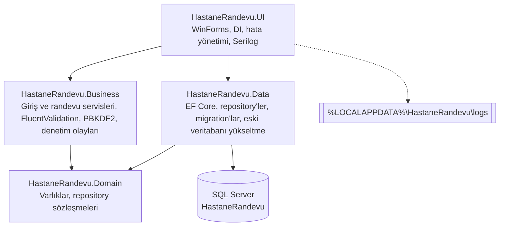

# 🏥 Hastane Randevu - Hastane Randevu Sistemi (C# & SQL Server)

🇬🇧 [English](README.md) · 🇹🇷 **Türkçe**

Hastaların doktorlardan randevu alıp listeleyip iptal edebildiği, doktorların da kendilerine alınan randevuları
görüp iptal edebildiği, .NET 10 ve SQL Server ile geliştirilmiş bir Windows Forms uygulaması. Ekranlar ve kurallar
kamu hastanelerinin çevrim içi randevu portallerinden esinlenmiştir; proje bağımsız bir eğitim uygulamasıdır ve
hiçbir resmî sistemle bağlantısı yoktur. Kod Domain, Business, Data ve UI katmanlarına ayrılmıştır; veritabanı
erişimi EF Core ile yapılır ve veritabanı açılışta otomatik olarak oluşturulup güncellenir.

> Uygulamanın arayüzü Türkçedir. İngilizce README'de ekran ve düğme adları "Türkçe etiket (English)" biçiminde,
> örneğin "Randevu Al" (Book Appointment) olarak verilir.

---

## 📦 Özellikler

### Hasta paneli

- ✅ **Kayıt** ("Üye Ol"): ad soyad, T.C. Kimlik No ve 8-64 karakter arası şifre. T.C. Kimlik No 11 hane ve
  sağlama algoritmasıyla denetlenir ve yalnızca bir kez kaydedilebilir.
- ✅ **Giriş** ("Giriş Yap"): T.C. Kimlik No ve şifre ile.
- ✅ **Randevu alma** ("Randevu Al"): branşıyla birlikte bir doktor ("Doktor Seçiniz"), bir gün ("Tarih Seçiniz")
  ve boş bir saat ("Saat Seçiniz") seçilir.
- ✅ **Doktor arama** ("Doktor Ara"): doktorlar ada ve branşa göre süzülür (Türkçe harflerle veya harfsiz).
- ✅ **İlk boş randevu** ("İlk Boş Randevu"): seçili doktorun 90 günlük aralıktaki en yakın boş dilimi servis
  tarafından bulunur ve alınmaya hazır olarak seçicilerde gösterilir.
- ✅ **Takvim** ("Takvim"): seçili doktorun ay veya hafta görünümü; boş (kaç dilim), dolu, izinli, çalışılmayan ve
  aralık dışı günler. Boş bir gün seçilince o günün saatleri gösterilir.
- ✅ **Randevularım** ("Aktif Randevularım"): hastanın kendi iptal edilmemiş randevuları; onaydan sonra iptal edilebilir
  ("Randevu İptal").
- ✅ **Erteleme** ("Ertele"): kendi randevusu aynı doktorun boş bir dilimine tek ve atomik bir adımda taşınır (iptal
  edilip yeniden alınmaz). Randevu başlamamış ve en az `Appointments:RescheduleCutoffHours` saat uzakta olmalıdır
  (varsayılan 2); yeni saat randevu alma kurallarına uyar.

### Doktor paneli

- ✅ **Giriş** ("Doktor Giriş"): doktorun adı soyadı ve şifresi ile.
- ✅ **Randevular** ("Sisteme Kayıtlı Randevular"): bu doktora alınan randevuların hastaları ve saatleri; iptal
  edilebilir ("İptal Et").
- ✅ **Çalışma programı** ("Çalışma Programım"): doktorun kendi çalışma günleri ve saatleri (yarım saatlik
  adımlarla, 00:00-24:00) ile izin ve tatil günleri. Mevcut randevular hiçbir zaman değiştirilmez; izin gününe veya
  yeni saatlerin dışına düşenler uyarı olarak listelenir.

### Randevu kuralları

- ✅ Her doktorun çalışma saatlerinden, izin günleri çıkarılarak üretilen 30 dakikalık dilimler. Hiç program
  kaydetmemiş bir doktor eski kuraldaki gibi hafta içi 09:00-17:00 çalışır (son dilim 16:30'da başlar); böylece
  mevcut veritabanları eskisi gibi davranır.
- ✅ Yalnızca ileri tarihli dilimler, en fazla 90 takvim günü sonrası (90. gün dahil).
- ✅ Bir doktor ve dilim için tek etkin randevu; iptal edilen dilim yeniden boşalır.
- ✅ İptal yalnızca randevu başlamadan önce yapılabilir; iptal edilen randevular geçmiş olarak saklanır.
- ✅ Saatler, eski uygulamanın sakladığı gibi yerel saattir.

### Güvenlik

- ✅ Şifreler PBKDF2-HMAC-SHA256 hash'i olarak saklanır (600.000 tekrar, rastgele tuz).
- ✅ 5 hatalı giriş hesabı 15 dakika kilitler; kilitli hesap, bilinmeyen hesap ve hatalı şifre aynı yanıtı alır.
- ✅ Her randevu çağrısı oturum açmış hesaba göre denetlenir; bir hesap başka hesapların randevularına numara
  vererek ulaşamaz.
- ✅ Türkçe mesajlı merkezi FluentValidation doğrulayıcıları; yazma düğmeleri işlem sürerken gelen tekrar
  tıklamaları yok sayar.
- ✅ Kişisel veri içermeyen günlük dosyaları; giriş, kilit ve randevular için anonim denetim kodları.

---

## 🔑 Yetki Matrisi

| İşlem | Hasta | Doktor |
|---|---|---|
| Hasta hesabı oluşturma | ✅ (giriş ekranından) | ❌ |
| Giriş | ✅ T.C. Kimlik No + şifre | ✅ ad soyad + şifre |
| Doktorları ve branşları listeleme | ✅ | ✅ (doktor panelinde gösterilmez) |
| Bir doktorun boş saatlerini görme | ✅ | ❌ |
| Randevu alma | ✅ yalnızca kendisi için | ❌ |
| Randevuları listeleme | ✅ kendi randevuları | ✅ kendisine alınanlar |
| Randevu iptali | ✅ kendi randevuları, başlamadan önce | ✅ kendisine alınanlar, başlamadan önce |
| Çalışma saatlerini ve izin günlerini değiştirme | ❌ | ✅ yalnızca kendi programı |
| Randevu erteleme | ✅ kendi randevuları, sınıra kadar | ❌ |
| Başka hesapların randevularını görme veya değiştirme | ❌ | ❌ |

---

## 🧰 Teknolojiler

| Alan | Kullanılan |
|---|---|
| Platform | .NET 10 (UI için `net10.0-windows`, kütüphaneler için `net10.0`) |
| Arayüz | Windows Forms |
| Veri erişimi | Entity Framework Core 10 (SQL Server sağlayıcısı) |
| Veritabanı | Microsoft SQL Server (Express veya LocalDB yeterli) |
| Şifre hash'leme | PBKDF2-HMAC-SHA256 (`Rfc2898DeriveBytes.Pbkdf2`) |
| Doğrulama | FluentValidation |
| Yapılandırma / DI | Microsoft.Extensions.Configuration (JSON, user secrets, ortam değişkenleri), Microsoft.Extensions.DependencyInjection |
| Günlük | Serilog (dosya, günlük dönen) |
| Test | xUnit v3, Moq, EF Core SQLite (bellek içi), isteğe bağlı gerçek SQL Server testleri |
| CI | GitHub Actions (`.github/workflows/ci.yml`) |

---

## 🗂️ Proje Yapısı

```text
HastaneRandevuSistemi/
├── src/
│   ├── HastaneRandevu.Domain/     # Varlıklar (Patient, Doctor, Appointment) ve repository sözleşmeleri
│   ├── HastaneRandevu.Business/   # AuthService, AppointmentService, Security/ (PBKDF2, kilit), Validation/ (FluentValidation), Auditing/
│   ├── HastaneRandevu.Data/       # EF Core DbContext, yapılandırmalar, Migrations/, eski veritabanı yükseltme, repository'ler
│   └── HastaneRandevu.UI/         # WinForms ekranları, Infrastructure/ (hata, günlük, ileti kutuları, yazma koruması), Program.cs (composition root)
├── tests/
│   ├── HastaneRandevu.Business.Tests/  # Doğrulayıcılar, kurallar, hash, kilit ve sahiplik (Moq)
│   ├── HastaneRandevu.Data.Tests/      # SQLite üzerinde servisler ve repository'ler; SQL Server'da yarışlar ve eski veritabanı yükseltme
│   └── HastaneRandevu.UI.Tests/        # Yapılandırma, hatalar, günlükler, ileti kutuları, odak ve yazma korumaları (pencere açılmaz)
├── assets/                        # SVG kaynaklarıyla özgün logo, arka plan ve simge
├── docs/THREAT_MODEL.md           # Tehdit modeli
├── .github/workflows/ci.yml       # Derleme, test ve sürüm iş akışı
├── CHANGELOG.md
└── HastaneRandevu.sln
```



UI, Data'ya yalnızca açılışta bağımlılıkları kaydetmek için başvurur; formlar, her çağrıda oturum açmış hesabı
alan Business servisleri üzerinden çalışır. Tüm veritabanı erişimi asenkron ve parametrelidir. Sağlayıcı DI
üzerinden (`AddDataAccess`) yapılandırılır, böylece testler bellek içi SQLite kullanabilir.

---

## 🛠️ Kurulum ve Kullanım

### Gereksinimler

- .NET 10 SDK (Windows)
- SQL Server (Express veya LocalDB yeterli)

### 1. Yapılandırma

`HastaneRandevu` adlı bir bağlantı dizesi verin. Aşağıdakilerden herhangi biri çalışır (sonrakiler öncekileri
geçersiz kılar):

1. **`appsettings.json`**: `src/HastaneRandevu.UI/appsettings.example.json` dosyasını aynı klasöre
   `appsettings.json` adıyla kopyalayın ve `ConnectionStrings:HastaneRandevu` değerini düzenleyin.
   `appsettings.json` git'e eklenmez.

   ```json
   {
     "ConnectionStrings": {
       "HastaneRandevu": "Server=localhost\\SQLEXPRESS;Database=HastaneRandevu;Trusted_Connection=True;TrustServerCertificate=True;"
     }
   }
   ```

2. **User secrets**:

   ```powershell
   dotnet user-secrets set "ConnectionStrings:HastaneRandevu" "<bağlantı dizesi>" --project src/HastaneRandevu.UI
   ```

3. **Ortam değişkeni** `ConnectionStrings__HastaneRandevu`.
4. **Ortam değişkeni** `HASTANE_CONNECTION` (en yüksek öncelik).

> JSON içinde `localhost\SQLEXPRESS` ifadesindeki `\` karakteri `\\` olarak yazılır. `TrustServerCertificate=True`
> yalnızca yerel geliştirme sunucusu içindir.

Bağlantı dizesi bulunamazsa uygulama bu seçenekleri açıklayan Türkçe bir mesaj gösterip kapanır.

`Appointments` bölümü ayarlanabilir kuralları içerir (varsayılanlar gösterilmiştir); geçersiz değerler, ayarın adını
veren Türkçe bir mesajla uygulamayı durdurur:

```json
"Appointments": {
  "RescheduleCutoffHours": 2
}
```

| Ayar | Anlamı | İzin verilen |
|---|---|---|
| `RescheduleCutoffHours` | Randevu, başlamasına bu kadar saat kalana kadar ertelenebilir | 0-168 |

### 2. Çalıştırma

```powershell
dotnet build -c Release
dotnet run --project src/HastaneRandevu.UI
```

Veritabanı ilk açılışta oluşturulur; bekleyen migration'lar her açılışta otomatik uygulanır, bu yüzden elle
`dotnet ef database update` çalıştırmaya ve `.bak` dosyasına gerek yoktur.

### 3. Mevcut veritabanını yükseltme

Eski uygulamanın oluşturduğu bir veritabanı (migration geçmişi olmayan `Hastalar`, `Doktorlar` ve `Randevular`
tabloları) ilk açılışta yerinde yükseltilir: mevcut satırlar ve kimlik değerleri korunur, eksik sütunlar, kısıtlar
ve indeksler eklenir ve migration'lar uygulanmış olarak kaydedilir; örnek veri eklenmez. O sürümün düz metin
şifreleri bu şekilde işaretlenir ve her hesabın bir sonraki başarılı girişinde hash ile değiştirilir. Yükseltme
tek bir transaction içinde, dönüş kodu denetlenen bir uygulama kilidi (`sp_getapplock`) altında çalışır ve
tekrarlanabilir. Mevcut satırlar yeni kuralları bozuyorsa (örneğin aynı adlı iki doktor ya da aynı saatte iki kez
randevu verilmiş bir doktor), yükseltme hiçbir şeyi değiştirmeden durur ve yalnızca sayıları bildirir; ad veya
T.C. Kimlik No bildirmez.

Yeni sürümle ilk açılıştan önce veritabanının yedeğini alın ve bu yedeği koruyun: düz metin şifreleri hâlâ içerir.

### 4. Demo modu

Varsayılan olarak veritabanı boş oluşturulur: migration'lar hiçbir hesap oluşturmaz, bu yüzden yayımlanmış hiçbir
şifre çalışmaz. Hastalar kendileri kayıt olur; uygulamada doktor ekleme ekranı yoktur, doktor hesaplarını
işletmeci `Doktorlar` tablosuna ekler (PBKDF2 hash'i ile, `SifreBicimi = 0`).

Demo modu, açıkça açılmadıkça kapalıdır: `HASTANE_DEMO=1` ortam değişkeni veya `"Seed": { "Demo": true }`
ayarıyla açılır. Yalnızca o zaman açılışta şu kurgusal hesaplar eklenir (yalnızca sağlama algoritmasını geçen
yapay T.C. Kimlik No'lar; mevcut satırlar hiçbir zaman değiştirilmez):

| Rol | Giriş (yalnızca demo modunda) | Şifre (yalnızca demo modunda) |
|---|---|---|
| Hasta | `10000000450` (Deniz Örnek) veya `10000000528` (Mert Deneme) | `Demo.Hasta1` |
| Doktor | `Dr. Ada Örnek` (Kardiyoloji), `Dr. Can Deneme` (Dahiliye) veya `Dr. Ece Taslak` (Ortopedi) | `Demo.Doktor1` |

Gerçek veri içeren bir veritabanında demo modunu asla açmayın. Bu uygulamanın önceki bir sürümüyle oluşturulan
veritabanlarına bu hesaplar otomatik eklenmişti; gerçek kullanımdan önce silin veya şifrelerini değiştirin.

### 5. Migration'lar

```powershell
dotnet tool restore
dotnet ef migrations list --project src/HastaneRandevu.Data
dotnet ef migrations add <Ad> --project src/HastaneRandevu.Data --output-dir Persistence/Migrations
```

Tasarım zamanı fabrikası `HASTANE_CONNECTION` değişkenini okur, yoksa yerel SQL Server Express örneğini kullanır.

### 6. Günlükler

Günlükler `%LOCALAPPDATA%\HastaneRandevu\logs\hastanerandevu-YYYYMMDD.log` dosyalarına, her gün için bir dosya
olarak yazılır; 30 günden eski dosyalar silinir ve en fazla 30 dosya saklanır. Klasör deponun dışındadır. Hata kayıtları yalnızca istisna türlerini,
HResult kodlarını ve yığın izindeki metot adlarını içerir (dosya yolu yok); reddedilen işlemler yalnızca istisna
türünü yazar. Denetim kayıtları sabit bir kod ve rolden oluşur, örneğin:

```text
2026-11-19 10:42:07.118 +03:00 [INF] Audit auth.sign_in.failed patient
2026-11-19 10:42:31.502 +03:00 [INF] Audit auth.sign_in.succeeded patient
2026-11-19 10:58:12.034 +03:00 [INF] Audit appointment.booked patient
```

T.C. Kimlik No'lar, adlar, şifreler, randevu ayrıntıları (doktor, branş, saat) ve istisna mesajları hiçbir zaman
günlüğe yazılmaz.

---

## 🔐 Güvenlik

Tehdit modeli için [docs/THREAT_MODEL.md](docs/THREAT_MODEL.md) dosyasına bakın (İngilizce).

- T.C. Kimlik No ve adlar kişisel veridir; belirli bir branştaki doktordan alınan randevu da kişinin sağlığı
  hakkında bilgi verir (KVKK). Bu veriler yalnızca yapılandırılan SQL Server veritabanında saklanır ve günlük
  dosyalarına yazılmaz. Oturum, T.C. Kimlik No'yu maskeli tutar (`100******50`).
- Şifreler PBKDF2 ile hash'lenir; saklama biçimi ayrı bir sütunda tutulur, böylece bir değer hiçbir zaman başka
  bir biçimde okunmaz. Daha zayıf veya düz metin şifreler bir sonraki başarılı girişte yükseltilir.
- Kilit sayaçları atomik olarak güncellenir ve başarılı giriş yalnızca hesap hâlâ kilitsizken yazılır; böylece eş
  zamanlı denemeler yeni konmuş bir kilidi kaldıramaz.
- Sahiplik servislerde denetlenir ve veritabanı `UPDATE` komutunda tekrarlanır; olmayan bir randevu ile başkasının
  randevusu aynı yanıtı alır, bu yüzden numaralar yoklanamaz.
- Bağlantı dizeleri depo dışında tutulur (`appsettings.json` yok sayılır; user secrets ve ortam değişkenleri
  desteklenir). Tüm sorgular EF Core üzerinden yapılır.
- Kullanıcılar yalnızca Türkçe mesajlar görür; ham istisna metni hiçbir zaman gösterilmez.
- Tüm kurulumlar tek bir SQL Server hesabını paylaşır, bu yüzden bağlantı dizesine sahip olan herkes tüm tabloları
  okuyabilir; bu hesaba yalnızca uygulamanın ihtiyaç duyduğu yetkileri verin ve yedekleri koruyun.

---

## 🧪 Test

### Elle test

1. Geçersiz bir T.C. Kimlik No (örneğin `12345678901`) veya 7 karakterlik bir şifreyle kayıt olmayı deneyin;
   sonra doğru bilgilerle kayıt olup giriş yapın.
2. Beş kez hatalı şifre girin: altıncı deneme doğru şifreyle bile aynı mesajla reddedilir ve 15 dakika sonra
   yeniden çalışır.
3. Bir saat için randevu alın, sonra aynı saati başka bir hasta hesabından almayı deneyin: dolu olarak bildirilir.
4. Hafta sonları ve 90 günden sonrası için saat sunulmadığını kontrol edin.
5. O randevunun doktoru olarak giriş yapıp randevuyu iptal edin; hastanın listesinde artık görünmez.
6. SQL Server'ı durdurun ve anlaşılır bir Türkçe hata gösterildiğini, günlük dosyasında yalnızca tür ve metot
   adları bulunduğunu kontrol edin.

### Otomatik testler

```powershell
dotnet test -c Release
```

| Proje | Tür | Kapsam | Sonuç (`-c Release`) |
|---|---|---|---|
| `tests/HastaneRandevu.Business.Tests` | Birim | Doğrulayıcı sınırları (şifre 8/64 ve girişte 100, ad 80, T.C. sağlama algoritması, 09:00-16:30 dilimleri, 90./91. gün, iptal sınırı), PBKDF2 ve biçim yükseltme, kilidin bitişi, sıkı Moq mock'larıyla sahiplik ve denetim olayları | 169 başarılı |
| `tests/HastaneRandevu.Data.Tests` | Entegrasyon | Bellek içi SQLite üzerinde servisler ve repository'ler (kilit zamanlaması, hash yükseltme, dilim ve ufuk sınırları, numara yoklama); SQL Server'da randevu ve kilit yarışları, eski veritabanı yükseltme ve kilidi | SQL Server ile 42 başarılı, 1 atlandı; olmadan 30 başarılı, 13 atlandı |
| `tests/HastaneRandevu.UI.Tests` | Birim | Örnek yapılandırma, hata mesajları, günlük içeriği ve dosyaları, ileti kutusu yardımcısı, kilit açıldıktan sonra odak, yazma korumaları, en son yanıtın gösterilmesi, tarafsız marka | 37 başarılı |

SQL Server testleri `HASTANE_TEST_SQLSERVER` değişkenindeki sunucuda (varsayılan: Windows kimlik doğrulamalı
yerel SQL Express) geçici veritabanları kullanır; `HASTANE_SKIP_SQL_TESTS=1` tanımlıysa veya sunucuya
ulaşılamıyorsa atlanır. Geçici veritabanları sonrasında silinir. Eski veritabanının geri yüklenmiş yedeğiyle
yapılan test yalnızca `HASTANE_LEGACY_BACKUP` bir `.bak` dosyasını gösterdiğinde çalışır.

```powershell
$env:HASTANE_SKIP_SQL_TESTS = "1"; dotnet test -c Release
```

SQLite üzerinde şema migration'lar yerine modelden oluşturulur. UI testleri formları göstermeden oluşturur, her
ileti kutusunu değiştirir ve sırayla çalışır; bu yüzden hiçbir pencere açılmaz.

---

## 🚀 CI ve Sürüm

`.github/workflows/ci.yml`; `main` dalına push'larda, pull request'lerde ve `v*` etiketlerinde çalışır (Windows,
.NET 10):

1. **Derleme:** `dotnet build -c Release`
2. **Test:** `dotnet test -c Release` (SQL Server testleri atlanır)
3. **Sürüm (yalnızca `v*` etiketlerinde):** etiket adı bir ortam değişkeniyle aktarılır ve
   `^v[A-Za-z0-9._-]+$` ile denetlenir; ardından çerçeveye bağımlı win-x64 derlemesi yayımlanır ve
   `HastaneRandevu-<etiket>-win-x64.zip` iş akışı çıktısı olarak yüklenir

Aynı derlemeyi yerelde üretmek için:

```powershell
dotnet publish src/HastaneRandevu.UI -c Release -r win-x64 --self-contained false -o ./publish
```

Hedef makinede .NET 10 Desktop Runtime gerekir. `appsettings.json` dosyasını `HastaneRandevu.exe` yanına koyun
veya `HASTANE_CONNECTION` değişkenini tanımlayın.

---

## 👨‍💻 Geliştirici Notları

- Sürüm geçmişi için [CHANGELOG.tr.md](CHANGELOG.tr.md) dosyasına bakın.
- `Program.cs` composition root'tur: yapılandırma, DI, günlük, denetim hedefi ve genel `ThreadException` /
  `UnhandledException` işleyicileri orada kurulur.
- İş kuralı ihlalleri `BusinessRuleException`, sahiplik ihlalleri `AccessDeniedException` fırlatır; ikisi de UI'nin
  uyarı olarak gösterdiği sabit Türkçe mesajlar taşır.
- Doğrulayıcılar `HastaneRandevu.Business/Validation` altındadır ve ilk hatada durur; kullanıcı her seferinde tek
  bir mesaj görür.
- Yeni yazma düğmeleri `RunExclusiveAsync` (`ExclusiveOperation`) üzerinden çalışmalı ve odağı
  `FocusAfterUnlock` ile taşımalıdır; bir seçimle tetiklenen yüklemeler, yalnızca en son yanıtın gösterilmesi
  için `RequestSequence` kullanmalıdır. İleti kutuları `MessageBox` ile doğrudan değil, `Dialogs` veya
  `IUserPrompts` üzerinden açılır.
- Denetim olayları (`IAuditLog`) yalnızca olay türü ve rol taşır; bunlara kimlik belirleyen veri eklemeyin.

---

## 📄 Lisans

Bu proje kişisel ve eğitimsel kullanım için ücretsizdir. Ticari amaçla kullanılması yasaktır.
